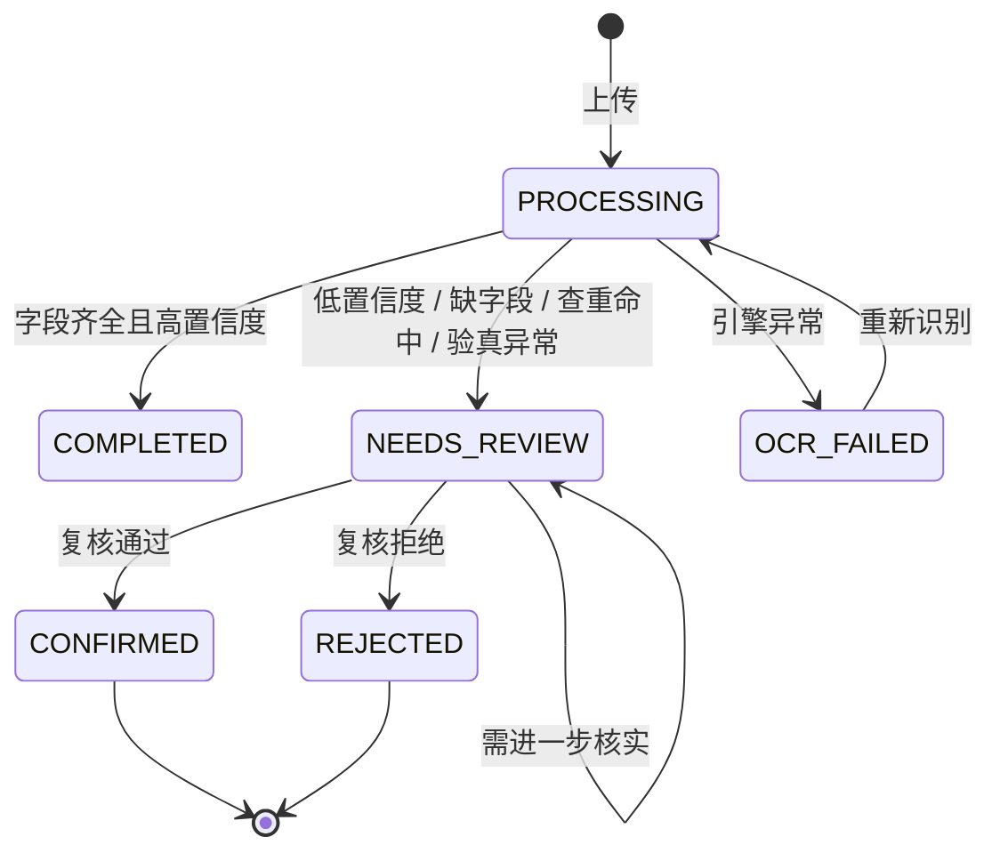
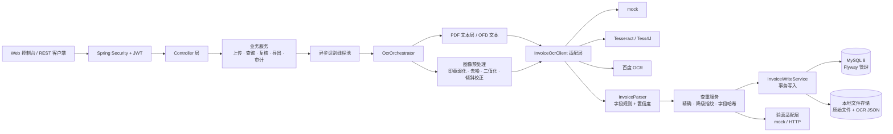

<div align="center">

# 发票 OCR 识别系统

**上传 → OCR → 结构化 → 查重 → 验真 → 人工复核，一条完整闭环**


基于 **Java 17 + Spring Boot 3.3 + MySQL 8 + Flyway** 的发票识别与复核系统。
开箱即用的 Web 控制台与 REST API，覆盖需求规格中的全部核心业务流程。

</div>

---

## 目录

- [项目简介](#项目简介)
- [功能特性](#功能特性)
- [系统架构](#系统架构)
- [技术栈](#技术栈)
- [快速开始](#快速开始)
- [使用流程](#使用流程)
- [配置说明](#配置说明)
- [OCR 引擎](#ocr-引擎)
- [验真渠道](#验真渠道)
- [API 概览](#api-概览)
- [实现要点](#实现要点)
- [数据库设计](#数据库设计)
- [测试](#测试)
- [目录结构](#目录结构)
- [已知限制](#已知限制)
- [反馈与交流](#反馈与交流)

---

## 项目简介

本项目面向企业财务报销、进项发票管理与费用审核场景，把发票图片 / PDF / OFD 中的关键字段自动提取为结构化数据，并提供查重、验真对接与人工复核工作流。

> **当前状态：v0.1 可运行初版。** 核心闭环已跑通，开箱即可体验。图片 OCR 需要安装 Tesseract 或配置百度 OCR 密钥（见 [OCR 引擎](#ocr-引擎)）；数字版 PDF / OFD 可直接抽取文本层，**无需任何外部引擎**。

**几行命令跑起来**：

```bash
mysql -uroot -p -e "CREATE DATABASE invoice_ocr CHARACTER SET utf8mb4 COLLATE utf8mb4_unicode_ci"
mvn -DskipTests package
java -jar target/invoice-ocr-0.1.0.jar
```

打开 <http://localhost:8080/>，使用 `admin / Admin@123` 登录即可。

---

## 功能特性

| 模块 | 能力 |
|---|---|
| 📤 文件上传 | JPG/PNG/BMP/PDF/OFD，扩展名 + MIME + 文件头三重校验，默认 10MB；SHA-256 文件去重，同文件直接返回历史结果 |
| 📄 文档处理 | PDF 文本层优先，扫描版降级为页面渲染 + OCR；OFD 解析 ZIP/XML 文本，扫描版提取内嵌图片后 OCR |
| 🖼️ 图像预处理 | 纯 Java 实现：红色印章弱化、灰度、中值降噪、Sauvola 二值化、投影法倾斜校正（可配置开关） |
| 🔌 OCR 适配层 | `InvoiceOcrClient` 接口；内置 `mock` / `tesseract`（Tess4J）/ `baidu` 三种实现，配置切换、失败自动降级 |
| 🧾 字段解析 | 规则集中管理（`InvoiceParser` / `FieldNames`）：票种、代码/号码/日期、购销方、金额、校验码、收付款人、商品明细；字段级置信度 0–100 |
| 🔍 发票查重 | 精确查重（代码 + 号码，DB 唯一索引）、降级指纹（销售方税号 + 日期 + 价税合计）、字段哈希（金额 + 日期 + 购销方税号）；行锁保证并发安全 |
| ✅ 验真对接 | `InvoiceVerificationClient` 适配层；mock 与通用 HTTP 渠道，支持手动 / 自动 / 仅复核触发，完整保留验真历史 |
| 🧑‍💼 人工复核 | 复核队列、逐字段修改留痕（前值 / 后值 / 人 / 时间）、结论（通过 / 拒绝 / 需核实）、修改后重算指纹 |
| 📚 台账查询 | 代码/号码/日期/购销方/税号/金额/类型/状态/查重/验真/时间/关键字组合查询，分页 |
| 📊 数据导出 | CSV（UTF-8 BOM、公式注入防护）与 XLSX（金额按字符串写入，避免浮点误差），字段可配置 |
| 🛡️ 审计 | 上传、识别、重复、复核、验真、导出、配置更新、登录成功/失败；记录操作人、角色、IP、对象、详情，只读 |
| 🔐 安全 | JWT 无状态认证、BCrypt 密码、四类角色权限、提交人数据隔离、密钥 AES-GCM 加密存储、短时效签名预览链接 |
| 🖥️ 管理后台 | 内置轻量 Web 控制台（登录、上传、台账、复核、详情、审计、配置），无需前端构建 |
| 📖 API 文档 | springdoc OpenAPI，访问 `/swagger-ui.html` |

<details>
<summary><b>发票状态流转</b></summary>



</details>

---

## 系统架构



分层单体架构，表现层、业务层、数据访问层清晰分离；OCR 与验真均为可插拔适配层，替换引擎不需要修改业务代码。

---

## 技术栈

| 层 | 选型 |
|---|---|
| 后端 | Java 17、Spring Boot 3.3.5、Spring Security 6、Spring Data JPA |
| 数据库 | MySQL 8.0 + Flyway（`src/main/resources/db/migration`） |
| OCR | Tess4J 5.11、Apache PDFBox 3.0、自研 OFD 文本抽取、百度 OCR 适配器 |
| 图像处理 | 纯 Java（ImageIO + 自研算法），不依赖 OpenCV 本地库 |
| 导出 | Apache POI 5.3（XLSX）、自研 CSV |
| 认证 | JJWT 0.12 |
| 前端 | 原生 HTML/CSS/JS，无构建步骤 |
| 测试 | JUnit 5、PDFBox 样例生成、解析 / 指纹单测 |

---

## 快速开始

### 环境要求

- JDK 17+
- Maven 3.9+
- MySQL 8.0+（默认连接 `localhost:3306`，账号 `root / 123456`）
- 可选：Tesseract 5.x + `chi_sim` 语言包（图片 OCR）
- 可选：百度 OCR API Key / Secret（商业 OCR）
- 无需 Redis / Docker

### 1. 初始化数据库

```sql
CREATE DATABASE invoice_ocr CHARACTER SET utf8mb4 COLLATE utf8mb4_unicode_ci;
```

表结构由 Flyway 在首次启动时自动创建。

### 2. 构建与运行

```bash
git clone https://github.com/MinakamiMai/invoice-ocr.git
cd invoice-ocr

# 使用 JDK 17
export JAVA_HOME=/path/to/jdk-17

mvn -DskipTests package
java -jar target/invoice-ocr-0.1.0.jar
```

Windows PowerShell：

```powershell
$env:JAVA_HOME = "C:\path\to\jdk-17"
mvn -DskipTests package
java -jar target\invoice-ocr-0.1.0.jar
```

启动后访问：

| 地址 | 说明 |
|---|---|
| <http://localhost:8080/> | Web 控制台 |
| <http://localhost:8080/swagger-ui.html> | Swagger UI |
| <http://localhost:8080/actuator/health> | 健康检查 |

> **存储路径提示**：默认存储目录为相对路径 `./data/storage`。如果从项目根目录之外启动 jar，请将 `APP_STORAGE_ROOT` 设为绝对路径，否则历史文件预览会 404。

### 3. 演示账号

首次启动自动创建（`app.seed.enabled=true`）：

| 角色 | 用户名 | 密码 | 权限 |
|---|---|---|---|
| 系统管理员 | `admin` | `Admin@123` | 配置、上传、查看、导出、验真、重识别；不可直接改识别字段 |
| 财务复核人员 | `reviewer` | `Review@123` | 复核队列、字段修改、验真、重识别 |
| 提交人员 | `submitter` | `Submit@123` | 上传、查看自己的发票 |
| 审计查看者 | `auditor` | `Audit@123` | 只读台账与审计日志 |

> ⚠️ **生产环境必须**通过 `SEED_*_PASSWORD` 修改初始密码、替换 `JWT_SECRET` 与 `APP_ENCRYPTION_KEY`，或关闭 seed 后自行建用户。

### 4. 跑通第一个闭环

```bash
mvn test   # 单元测试会生成 samples/sample-invoice.pdf（文本型 PDF，内嵌中文字体）
```

登录控制台 → 上传识别 → 选择 `samples/sample-invoice.pdf` → 状态变为「已识别」→ 在台账中查看详情。该样例不依赖任何外部 OCR 引擎。

---

## 使用流程

1. **提交人员**登录 → 上传发票 → 系统异步识别并查重。
2. 状态为 `COMPLETED` 的发票进入台账；`NEEDS_REVIEW` 进入复核队列；`OCR_FAILED` 可重试。
3. **复核人员**打开待复核发票 → 对照原始图像 → 修改字段 → 选择结论：
   - 通过 → `CONFIRMED`
   - 拒绝 → `REJECTED`
   - 需进一步核实 → 保持 `NEEDS_REVIEW`
4. 每次字段修改写入 `review_record`，并重新计算三类查重指纹。
5. 可手动触发验真，也可配置识别后自动验真。验真结论仅供参考，不替代人工结论。
6. **审计查看者 / 管理员**查看审计日志；**管理员**调整 OCR / 验真 / 预处理配置。
7. 台账支持组合筛选与 CSV / XLSX 导出。

---

## 配置说明

### 环境变量

| 变量 | 默认 | 说明 |
|---|---|---|
| `SERVER_PORT` | `8080` | HTTP 端口 |
| `DB_URL` | `jdbc:mysql://localhost:3306/invoice_ocr?...` | 数据库连接 |
| `DB_USERNAME` / `DB_PASSWORD` | `root` / `123456` | 数据库账号 |
| `JWT_SECRET` | 内置开发密钥 | **生产必须替换**，至少 32 字节 |
| `JWT_TTL_MINUTES` | `480` | Token 有效期（分钟） |
| `APP_ENCRYPTION_KEY` | 内置开发密钥 | 配置密钥加密用，生产必须设置（32+ 字符） |
| `APP_STORAGE_ROOT` | `./data/storage` | 原始文件与 OCR 结果存储根目录 |
| `APP_MAX_FILE_SIZE` | `10485760` | 单文件大小限制（字节） |
| `TESSERACT_DATAPATH` | 空 | Tesseract `tessdata` 目录（也可在管理后台配置） |
| `TESSERACT_LANGUAGE` | `chi_sim+eng` | Tesseract 语言包 |
| `APP_SEED_ENABLED` | `true` | 是否初始化演示用户与默认配置 |
| `SEED_*_PASSWORD` | 见上表 | 演示账号初始密码 |

### 运行时配置（管理后台）

管理员可在「系统配置」中修改，立即对新任务生效：

<details>
<summary><b>展开全部配置项</b></summary>

- `ocr.engine`：`mock` / `tesseract` / `baidu`
- `ocr.fallback-engine`：主引擎失败后的降级引擎，可留空
- `ocr.confidence.threshold`：字段置信度阈值（默认 80）
- `ocr.pdf.min-text-chars` / `ocr.pdf.max-pages` / `ocr.ofd.max-images`
- `ocr.tesseract.datapath` / `ocr.tesseract.language`
- `ocr.baidu.api-key` / `ocr.baidu.secret-key`（加密存储）
- `preprocess.enabled` / `preprocess.deskew` / `preprocess.stamp-suppression`
- `dedup.fallback.enabled` / `dedup.field-hash.enabled`
- `verify.trigger`：`MANUAL` / `AUTO` / `REVIEW_ONLY`
- `verify.channel`：`mock` / `http`
- `verify.http.endpoint` / `verify.http.api-key`（加密）/ `verify.http.timeout-ms` / `verify.http.retries`
- `storage.retention-years`（记录策略值，清理任务未实现）
- `export.max-rows`

密钥类配置的读取接口只返回 `******`；更新时提交 `******` 表示保持不变，提交空字符串表示清除。

</details>

---

## OCR 引擎

### `mock`（默认，联调用）

对图片返回空文本，因此图片上传会进入 `NEEDS_REVIEW`，不会伪造发票字段。数字版 PDF / OFD 在到达引擎前已抽取文本，不受影响。

### `tesseract`（开源离线）

1. 安装 Tesseract 5.x。
2. 下载 `chi_sim.traineddata` 放入 `tessdata` 目录。
3. 管理后台配置 `ocr.tesseract.datapath` 为 `tessdata` 的**父目录**（Tess4J 会拼接 `tessdata`），`ocr.tesseract.language=chi_sim+eng`。
4. 将 `ocr.engine` 切换为 `tesseract`，上传图片验证。

> Tesseract 对发票表格和印章的识别率有限，建议配合预处理或改用商业 API。

### `baidu`（商业）

1. 在百度智能云开通「增值税发票识别」并创建应用。
2. 管理后台填写 `ocr.baidu.api-key` 与 `ocr.baidu.secret-key`。
3. 将 `ocr.engine` 切换为 `baidu`。

适配器调用 `vat_invoice` 接口，返回的结构化字段以置信度 95 注入解析器；商品明细拼接为文本行供规则解析。密钥使用 AES-GCM 加密存储，错误信息中的 token / client_secret 会被脱敏。

### 降级与重试

- 主引擎异常时，若配置了 `ocr.fallback-engine`，自动尝试降级引擎。
- 百度 OCR 内部最多重试 2 次；HTTP 验真渠道同样最多重试 2 次。
- 引擎最终失败时任务置为 `OCR_FAILED`，保留原始文件与错误信息，可通过「重新识别」重试。

---

## 验真渠道

内置两种 `InvoiceVerificationClient`：

- **`mock`**：检查六要素（代码、号码、日期、校验码、不含税金额、类型）是否齐全，返回「一致 / 不一致」。**不连接税务平台，仅供联调**，摘要中会明确标注。
- **`http`**：向 `verify.http.endpoint` POST JSON：

```json
{
  "invoiceCode": "011002200111",
  "invoiceNumber": "12345678",
  "invoiceDate": "2026-11-10",
  "checkCode": "12345678901234567890",
  "amountWithoutTax": 1000.00,
  "invoiceType": "VAT_E_NORMAL",
  "grandTotal": 1060.00
}
```

期望响应：

```json
{ "status": "CONSISTENT", "message": "一致" }
```

`status` 支持 `CONSISTENT / INCONSISTENT / NOT_FOUND` 或 `MATCH / MISMATCH`。请求头自动携带 `Authorization: Bearer <verify.http.api-key>`。

验真结果写入 `verification_record`，并在发票详情中展示历史；验真不一致 / 异常 / 查无此票的发票会出现在复核队列。

---

## API 概览

所有接口（除登录、签名文件预览外）需要 `Authorization: Bearer <JWT>`。

| 方法 | 路径 | 角色 | 说明 |
|---|---|---|---|
| POST | `/api/auth/login` | 公开 | 登录，返回 JWT |
| GET | `/api/auth/me` | 登录用户 | 当前用户 |
| POST | `/api/invoices/upload` | SUBMITTER / REVIEWER / ADMIN | multipart 上传，返回 202 + invoiceId |
| GET | `/api/invoices/{id}` | 有权限用户 | 详情；识别中返回任务状态 |
| GET | `/api/invoices` | 登录用户 | 分页台账（提交人自动限本人） |
| POST | `/api/invoices/{id}/review` | REVIEWER | 字段修改 + 结论 |
| POST | `/api/invoices/{id}/verify` | REVIEWER / ADMIN | 手动验真 |
| POST | `/api/invoices/{id}/reprocess` | REVIEWER / ADMIN | 重新识别（失败 / 待复核） |
| GET | `/api/invoices/{id}/file?expires=&sig=` | 签名链接 | 预览 / 下载原始文件 |
| GET | `/api/invoices/export` | 登录用户 | CSV / XLSX 导出 |
| GET | `/api/review-tasks` | REVIEWER / ADMIN | 复核队列 |
| GET | `/api/audit-logs` | ADMIN / AUDITOR | 审计日志 |
| GET / PUT | `/api/admin/config` | ADMIN | 读取 / 更新配置 |
| GET | `/actuator/health` | 公开 | 健康检查 |

<details>
<summary><b>示例：登录、上传并轮询</b></summary>

```bash
TOKEN=$(curl -s -X POST http://localhost:8080/api/auth/login \
  -H 'Content-Type: application/json' \
  -d '{"username":"submitter","password":"Submit@123"}' | jq -r .token)

curl -s -X POST http://localhost:8080/api/invoices/upload \
  -H "Authorization: Bearer $TOKEN" \
  -F "file=@samples/sample-invoice.pdf"
# {"invoiceId":"...","status":"PROCESSING",...}

curl -s http://localhost:8080/api/invoices/<invoiceId> \
  -H "Authorization: Bearer $TOKEN"
```

</details>

<details>
<summary><b>示例：复核</b></summary>

```bash
curl -s -X POST http://localhost:8080/api/invoices/<invoiceId>/review \
  -H "Authorization: Bearer $REVIEWER_TOKEN" \
  -H "Content-Type: application/json" \
  -d '{"fields":{"sellerName":"新销售方名称"},"conclusion":"PASS","comment":"已核对原件"}'
```

复核结论：`PASS` / `REJECT` / `NEEDS_MORE_INFO`。

</details>

<details>
<summary><b>台账查询参数</b></summary>

`GET /api/invoices` 支持：

`id`、`invoiceCode`、`invoiceNumber`、`invoiceDateFrom/To`、`sellerName`、`sellerTaxId`、`buyerName`、`buyerTaxId`、`amountMin/Max`、`invoiceType`、`status`、`duplicateFlag`、`verificationStatus`、`uploadFrom/To`、`keyword`、`page`（0 起）、`size`（默认 20，最大 200）、`sortBy`、`sortDir`。

</details>

---

## 实现要点

### 异步识别

上传只做校验、存文件、建 `ocr_task`，立即返回 `202 Accepted`。识别在 `ocrExecutor` 线程池中执行：

```
读取文件 → OcrOrchestrator（文本层 / 图像 + 预处理）→ InvoiceParser → 规则校验
→ 查重 → InvoiceWriteService（事务）→ 状态评估 → 自动验真（可选）
```

客户端通过 `GET /api/invoices/{invoiceId}` 轮询；识别中的 ID 没有 `invoice` 行时，返回 `ocr_task` 的任务状态。

### 查重并发安全

- **精确重复**：数据库唯一索引 `(invoice_code, invoice_number)` 兜底；插入冲突时返回已存在发票，任务标记 `DUPLICATE`，不重复入库。
- **降级重复**：同一指纹在 `dedup_registry` 中 `INSERT IGNORE` 后 `SELECT ... FOR UPDATE`，串行化并发判定；命中后仍保存新发票但标记 `duplicateFlag=1`、`duplicateOfId`。
- **字段哈希**：跨票种 / 跨批次碰撞检测，仅标记不阻断。
- 精确重复不会创建第二条 `invoice` 记录；响应中返回历史发票 ID 与 `duplicateType`。

### 字段置信度与复核触发

- 解析器为每个成功字段写入置信度：文本层 100、OCR 行取引擎行置信度、商业 API 95、派生值 60–85。
- 低于 `ocr.confidence.threshold` 的字段、缺失必填字段、金额校验不一致、税号 / 号码格式异常、查重命中，均进入 `NEEDS_REVIEW`。
- 复核修改字段时，该字段置信度置为 100。

### 文件与预览

- 原始文件保存为 `data/storage/files/yyyy/MM/dd/{invoiceId}-{random}.{ext}`，与原始文件名解耦。
- OCR 原始结果保存为 `data/storage/ocr-results/{invoiceId}/{taskId}.json`，`ocr_task.raw_result_ref` 可追溯。
- 详情接口返回 HMAC 签名、默认 10 分钟有效的预览链接；无需 JWT，但篡改签名或过期返回 403。

### 安全与审计

- 角色：提交人员只能访问自己上传的发票；复核人员可看全部并复核；审计查看者只读；管理员可改配置但不能直接改识别字段。
- 文件扩展名、MIME、文件头三重校验，拒绝伪装文件。
- API 密钥 / 验真密钥 AES-GCM 加密存储，管理接口脱敏；日志与错误信息不打印密钥。
- 审计日志只有查询接口，没有删除接口。

---

## 数据库设计

Flyway `V1__init.sql` 创建以下表：

`app_user`、`invoice`、`invoice_item`、`ocr_task`、`review_record`、`verification_record`、`audit_log`、`system_config`、`dedup_registry`

要点：

- 金额统一 `DECIMAL(18,2)`，数量 / 单价 `DECIMAL(18,4)`；Java 统一 `BigDecimal`，禁止浮点。
- `invoice` 对 `(invoice_code, invoice_number)` 建唯一索引（NULL 可重复，由降级指纹补位）。
- 指纹、状态、日期、购销方、文件哈希、上传人、创建时间均有索引。
- 原始文件 / OCR 结果存储在文件系统，数据库只存相对引用。

完整需求规格见仓库中的 [`需求.txt`](需求.txt)。

---

## 测试

```bash
mvn test
```

| 测试类 | 覆盖内容 |
|---|---|
| `InvoiceParserTest` | 标准电普票解析、数电票识别、低置信度、税号异常 |
| `FingerprintServiceTest` | 精确 / 降级 / 字段指纹确定性与缺失场景 |
| `SampleInvoiceGeneratorTest` | 生成 `samples/sample-invoice.pdf`，并通过 PDF 文本层 + 解析器端到端校验 |

<details>
<summary><b>手工验收路径</b></summary>

1. 上传 `samples/sample-invoice.pdf` → 五要素、购销量、金额、校验码、商品明细正确，状态 `COMPLETED`。
2. 再次上传同一文件 → 返回已有结果，`duplicateFlag=true`。
3. 上传内容相同但文件字节不同的副本 → 任务 `DUPLICATE`，只保留一条发票。
4. 上传模糊图片（mock 引擎）→ `NEEDS_REVIEW`，复核队列可见。
5. 复核修改字段并「通过」→ `CONFIRMED`，`review_record` 中有前后值与复核人。
6. 触发验真 → `verification_record` 新增记录，详情展示历史。
7. 导出 CSV / XLSX → 金额字符串无精度损失。
8. 审计日志可查到上传、识别、复核、验真、导出、配置更新。

</details>

---

## 目录结构

```
invoice_ocr/
├── pom.xml
├── samples/
│   └── sample-invoice.pdf          # mvn test 生成
├── src/main/java/com/invoiceocr/
│   ├── config/                     # 配置、安全、线程池、初始化
│   ├── domain/                     # JPA 实体与枚举
│   ├── dto/                        # API DTO
│   ├── ocr/                        # OCR 适配层、PDF/OFD 抽取、编排
│   ├── parser/                     # 规则解析、字段名与置信度
│   ├── preprocess/                 # 纯 Java 图像预处理
│   ├── repo/                       # Spring Data 仓库
│   ├── security/                   # JWT、当前用户
│   ├── service/                    # 上传、识别、查重、复核、查询、导出、审计、验真
│   ├── util/                       # 哈希、加密、IP
│   ├── verify/                     # 验真适配层
│   └── web/                        # REST 控制器与异常处理
├── src/main/resources/
│   ├── application.yml
│   ├── db/migration/V1__init.sql
│   └── static/                     # 内置 Web 控制台
└── src/test/java/com/invoiceocr/   # 单元 / 端到端测试
```

---

## 已知限制

初版有意控制复杂度，以下能力尚未完整实现：

1. **图片 OCR 依赖外部引擎**：默认 `mock` 不识别图片；Tesseract 需自行安装语言包；百度适配器未用真实账号做线上回归。
2. **商品明细解析为启发式**：对跨行 / 多列 OCR 文本的还原能力有限，复杂票面建议接入商业 OCR 的结构化字段。
3. **OFD**：数字版文本抽取可用；扫描版仅提取内嵌图片，未实现完整 OFD 渲染。
4. **验真 mock 渠道不连接税局**：结果仅用于联调，生产需配置真实 HTTP 渠道。
5. **上传始终异步返回 202**：客户端需轮询；批量上传与进度推送未实现。
6. **Redis 未接入**：查重并发依靠 MySQL 唯一索引 + 注册表行锁，满足正确性；高并发场景可增加 Redis 缓存 / 分布式锁。
7. **图像预处理为自研纯 Java 实现**，未使用 OpenCV；参数只提供开关，未开放阈值调节。
8. **运维能力**：保留期清理、审计归档、JWT 吊销 / 刷新、批量导入、发票原件下载水印等尚未实现。
9. `storage.retention-years` 目前只是配置项，未挂定时清理任务。
10. 复核修改关键字段后不会自动清除旧验真结果（历史记录保留，供审计）。

**后续路线**：接入真实商业 OCR / 验真渠道 → 完善商品明细解析 → 增加 Redis 与对象存储 → 补充集成测试与压测 → 配置密钥轮换与监控告警。

---

## 反馈与交流

- 发现 Bug 或有功能建议，欢迎提交 [Issue](../../issues)。
- 提交代码前请先运行 `mvn test`，保持现有用例通过。
- 如果你的使用场景涉及真实发票数据，请务必替换默认密钥与演示密码。

<div align="center">

**如果这个项目对你有帮助，欢迎点一个 ⭐ Star**

</div>
